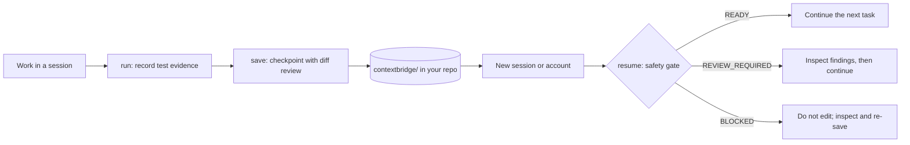
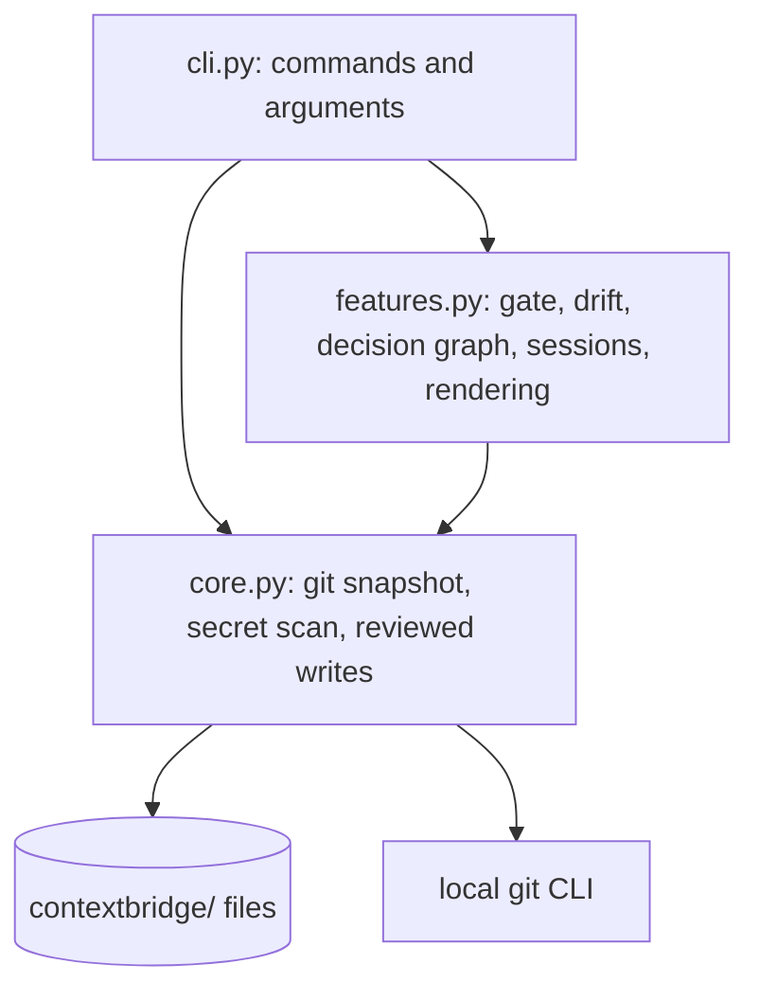

<div align="center">

# ContextBridge

**Your AI coding sessions can end. Your engineering context shouldn't.**

[](https://github.com/Abhinay2206/ContextBridge/actions/workflows/ci.yml)
[](https://pypi.org/project/contextbridge-cli/)
[](https://pypi.org/project/contextbridge-cli/)
[](LICENSE)

[Quick start](#quick-start) · [How it works](#how-it-works) · [Security](#security-and-privacy) · [Limitations](#limitations)

</div>

ContextBridge preserves the **state of the work, not just the story of the conversation**. It checkpoints your project into plain files inside your own repository, records which tests were actually run, and, when a new session or a different account picks the work up, checks the checkpoint against the real workspace before anyone edits code.

Everything is stored locally in the repository. There is no account, server, or telemetry.

## Contents

- [The problem](#the-problem)
- [How it works](#how-it-works)
- [Features](#features)
- [Quick start](#quick-start)
- [Example: authentication work across two sessions](#example-authentication-work-across-two-sessions)
- [Cross-account workflow](#cross-account-workflow)
- [Architecture](#architecture)
- [Security and privacy](#security-and-privacy)
- [Limitations](#limitations)
- [Development](#development)
- [Roadmap](#roadmap)
- [License](#license)

## The problem

A new AI coding session usually starts without the old conversation. That causes predictable failures:

- Decisions, and the approaches that were rejected, are forgotten.
- A handoff describes work as done that was never verified.
- The repository changed after the handoff was written, so it is stale.
- The next agent repeats finished work or acts on outdated assumptions.

A summary written from memory cannot detect any of this. ContextBridge records evidence from the workspace and compares it again at resume time.

## How it works



ContextBridge carries **portable project state**: git position, uncommitted-file hashes, executed test runs, work status, decisions, and a next action. ContextBridge does not transfer chats, private chat history, account memory, or usage allowance.

The resume gate returns one of three verdicts, with matching exit codes:

| Verdict | Exit | Meaning |
|---|---|---|
| `READY` | 0 | No conflicts detected. |
| `REVIEW_REQUIRED` | 1 | Files edited or committed since the checkpoint, stale or failed test evidence, failed assumptions, or overlapping session claims. |
| `BLOCKED` | 2 | No, corrupt, or unsupported checkpoint; branch changed; history rewritten; or git unavailable. The resume prompt is withheld. |

## Features

| Capability | Status | Commands |
|---|---|---|
| Checkpoints of real git state (branch, HEAD, uncommitted files with SHA-256) | Implemented | `save`, `checkpoint` |
| Executed-command evidence (exit code, timestamp, redacted output tail; interrupted runs stay visible) | Implemented | `run -- <cmd>` |
| Work split into completed, attempted and planned | Implemented | `work add`, `work set` |
| Provenance: observed facts vs. claims, with the claimant's name | Implemented | `CONTEXTBRIDGE_AGENT`, `--evidence` |
| Decision graph: requirement → decision → code → test, with rejected alternatives | Implemented | `decision add`, `graph query`, `graph trace`, `graph check` |
| Drift detection against the current workspace | Implemented | `drift` |
| Resume safety gate with JSON output | Implemented | `resume`, `resume --check --json` |
| Portable JSON bundle (`schema: contextbridge/1`) and agent-neutral resume prompt | Implemented | `export`, `import`, `resume` |
| Secret scanning, default file exclusions, reviewed diffs before writes | Implemented | `scan`, `.contextbridgeignore`, `--redact` |
| Local-only notes (kept out of git) | Implemented | `init --local-only` |
| Session path claims and overlap warnings | Partial: advisory, one repository only | `session start`, `session list`, `session finish` |
| Claude Code plugin commands and Claude skill | Partial: prompts that guide the model | see [Quick start](#quick-start) |
| Multi-worktree and cross-clone coordination | Planned | none |

## Quick start

**Prerequisites:** Python 3.9 or newer and Git. The CLI has no other dependencies.

### 1. Install the CLI

```bash
pip install contextbridge-cli
contextbridge --version
```

`save`, the resume gate and provenance require version 0.3.0 or later. To work from source instead:

```bash
git clone https://github.com/Abhinay2206/ContextBridge.git
cd ContextBridge
pip install .
```

### 2. Initialize a project

```bash
cd your-repo
contextbridge init --local-only   # optional: keep notes out of git
```

### 3. Record evidence and create a checkpoint

```bash
contextbridge run -- python3 -m unittest -q
contextbridge work add "Login endpoint" --status completed --evidence E1
contextbridge work add "Refresh-token tests" --status planned --path tests/test_refresh.py
contextbridge save --objective "Add token-based auth" \
  --next "Finish refresh-token tests" --next-path tests/test_refresh.py
```

`save` shows a diff of every file it will write and asks before applying it. In non-interactive shells it prints the diff and exits with code 3 unless you pass `--yes`.

### 4. Resume in a new session

```bash
contextbridge resume            # gate verdict, then the handoff prompt
contextbridge resume --check    # verdict only
contextbridge drift             # full list of differences
```

Paste the `resume` output into any coding assistant, or let it run the command itself.

### Optional: use it from Claude

These are two different mechanisms. Install the one you need.

**Claude Code plugin** adds `/contextbridge:init`, `/contextbridge:checkpoint`, `/contextbridge:resume` and `/contextbridge:status`. The commands call the CLI when it is installed and otherwise guide the model through the same steps manually.

```text
/plugin marketplace add Abhinay2206/ContextBridge
/plugin install contextbridge@abhinay-contextbridge
```

**Claude.ai skill** is a separate upload of [`dist/contextbridge-skill.zip`](dist/contextbridge-skill.zip) under Customize → Skills (menu names may vary). A browser chat cannot read your local repository or run the CLI unless you provide files or a code-execution environment.

## Example: authentication work across two sessions

The scenario: one session finishes the login endpoint and records a passing test run. Refresh-token integration tests remain. The developer switches accounts, and someone edits `src/auth.py` in between.

The output below was captured from a real run of ContextBridge 0.3.0 in a temporary repository (commit hashes and timestamps vary).

```text
$ contextbridge run -- python3 -m unittest -q
E1 `python3 -m unittest -q` -> PASSED (exit 0, 0.11s)

$ contextbridge resume --check      # new session, after src/auth.py was edited
## Resume safety gate: REVIEW_REQUIRED
Do not edit yet. Inspect each item below, reconcile it with the code or the user, then proceed.

[WARN ] src/auth.py: new uncommitted change since checkpoint
[WARN ] no passing test run matches the current workspace state; re-run tests before trusting 'done'
```

The generated handoff keeps what was observed apart from what was claimed:

```text
## Completed
- W1: Login endpoint [src/auth.py] — verified by E1 PASSED exit 0 @ 2026-10-11T19:04:27Z

## Planned (not started)
- W2: Refresh-token integration tests [tests/test_refresh.py] — claimed by claude-account-a
```

A passing run shows that the command succeeded at that time. It does not prove the software is correct.

## Cross-account workflow

Separate Claude accounts do not share conversations or account memory. They can share a repository.

1. Use the same repository on both sides: the same clone, a synced folder, or two clones of the same remote.
2. In the first session, run `contextbridge save`. Commit `contextbridge/` or sync it, but only after reviewing it for sensitive content.
3. Switch accounts and open the same project.
4. Run `contextbridge resume`.
5. Resolve every item the gate lists before making changes.

Without `init --local-only`, the notes live in `contextbridge/` and travel with the repository. You can also move them as one file with `export -o bundle.json` and `import bundle.json`. `import` replaces the local state, graph and sessions after showing a diff.

Set `CONTEXTBRIDGE_AGENT` (for example `claude-account-a`) so each claim in the handoff names its author. The tool never guesses it.

## Architecture



| Component | Location | Role |
|---|---|---|
| CLI entry point | `contextbridge` console script → `contextbridge.cli:main` | Argument parsing and command handlers |
| State | `contextbridge/state.json` | Objective, next action, snapshot, work, evidence, assumptions (schema `contextbridge/1`) |
| Decision graph | `contextbridge/graph.json` | Requirement, decision, code and test nodes and edges |
| Sessions | `contextbridge/sessions.json` | Path claims per session |
| Generated notes | `HANDOFF.md`, `DECISIONS.md` | Human-readable renderings; edit through the CLI |
| Evidence model | `state.json` → `evidence` | Command, status, exit code, timestamp, HEAD, workspace fingerprint, redacted output tail |
| Drift and gate | `features.py` | Compares the checkpoint snapshot and records with the live workspace |
| Plugin and skill | `.claude-plugin/`, `commands/`, `skills/contextbridge/` | Prompts that drive the CLI or the manual workflow |

The workspace fingerprint is a hash of HEAD plus the path and content hash of every uncommitted file. A test run counts as matching only when its fingerprint equals the current one.

## Security and privacy

- **What is stored:** git branch and HEAD, paths and SHA-256 hashes of uncommitted files, command lines, exit codes, a 15-line redacted tail of command output, and the notes you write. File contents are not stored.
- **Where:** plain files under `contextbridge/` in your repository, plus `.contextbridgeignore` if you create exclusions.
- **Network:** none. The code makes no network calls and sends no telemetry. It runs the local `git` executable, and `run` executes the command you give it.
- **Exclusions:** `.env*`, `*.pem`, `*.key`, `id_rsa*`, `secrets.*` and similar files are never recorded. Add patterns in `.contextbridgeignore`.
- **Secret scanning:** writes under `contextbridge/` and exports are scanned for common token and key patterns, and refused unless you pass `--redact`. The scanner is pattern-based and best-effort. It will miss some secrets, so review diffs before sharing.
- **Imported context:** treated as data. Importing never executes anything. Commands run only when you invoke `contextbridge run`. The resume prompt tells the agent to treat the notes as untrusted.
- **Confirmation:** `save`, `checkpoint`, `work`, `decision`, `assume`, `session`, `import` and `graph render` show a diff and ask before writing. `run` records its result without a prompt, because you chose to run the command. `init` creates `.contextbridgeignore`, and `--local-only` edits `.git/info/exclude`, without a diff. `export` writes the file you name after scanning it.

Report vulnerabilities as described in [SECURITY.md](SECURITY.md).

## Limitations

- Provider integration is limited to prompts. The plugin commands and skill guide a model, and the CLI does the checking. Neither can force a model to follow the verdict.
- Recorded test evidence shows that a command succeeded, not that the software is correct or the tests are meaningful.
- Drift compares files and commits, not meaning. It cannot tell whether a changed file finished a task.
- Session coordination is advisory. It sees claims stored in one repository, not other clones or machines.
- Chat histories, account memory and usage allowance are not transferred.
- Continuous integration covers Ubuntu, macOS and Windows with Python 3.9 and 3.12. Other combinations are untested.
- The Claude.ai skill cannot run the CLI or read local files on its own.

## Development

```bash
git clone https://github.com/Abhinay2206/ContextBridge.git
cd ContextBridge
python3 -m unittest discover -s tests -v
```

The suite has package checks (`tests/test_package.py`) and end-to-end tests that drive the real CLI against temporary git repositories (`tests/test_e2e.py`). A manual checklist for the prompts is in [`tests/TEST_PLAN.md`](tests/TEST_PLAN.md).

`main` is protected. Contributions arrive as pull requests with passing CI; see [CONTRIBUTING.md](CONTRIBUTING.md). Changes are listed in [CHANGELOG.md](CHANGELOG.md).

## Roadmap

**Shipped:** checkpoints, executed-command evidence, provenance, decision graph, drift detection, resume safety gate, export and import, secret scanning, advisory session claims.

**Ideas, not committed:**

- Git-worktree-aware coordination.
- A reproducible benchmark that compares plain handoff prompts with ContextBridge.
- A compact resume bundle with on-demand recall.
- An MCP server so other assistants can call the gate directly.

## License

[MIT](LICENSE). Copyright (c) 2026 Abhinay, project maintainer.

---

Try it on a throwaway branch, [open an issue](https://github.com/Abhinay2206/ContextBridge/issues) when something is unclear or wrong, and read [CONTRIBUTING.md](CONTRIBUTING.md) if you want to help.
